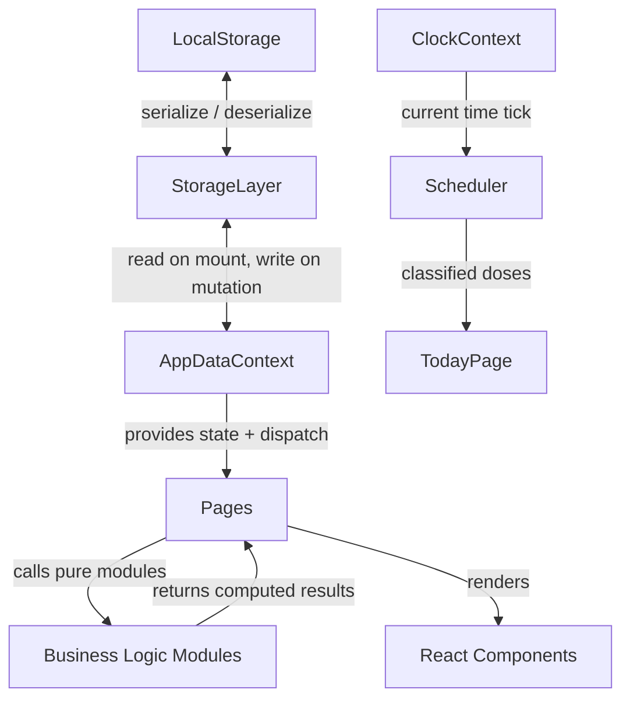

# MediTrack — Design Document

## Open Decision

> **Refill Tracking:** Whether to include low-stock warnings and refill tracking is an **unresolved open decision**. This feature is excluded from all design decisions below until a decision is made. No component, data model, or storage key has been reserved for it.

---

## Overview

MediTrack is a frontend-only single-page application (SPA) built with React 18 and TypeScript. There is no backend, no authentication, and no network layer. All state is kept in React component state and React Context, and is persisted to browser LocalStorage through a storage abstraction layer.

The application has five primary screens:

1. **Today View** — dose schedule for the current day with status tracking
2. **Medicines** — create, edit, and delete medicine records with their dose schedules
3. **Health Log** — record and review blood pressure, blood sugar, and weight readings
4. **Weekly Summary** — filterable adherence report for a selected Monday-to-Sunday week
5. **Trends** — averages and trend indicators for health metrics over a date range

The UI follows a mobile-first light theme with teal/blue as the primary color and meets WCAG 2.1 AA contrast requirements.

---

## Architecture

### High-Level Structure

```
src/
├── models/           # TypeScript types and interfaces (pure data)
│   ├── Medicine.ts
│   ├── Dose.ts
│   ├── DoseRecord.ts
│   ├── HealthReading.ts
│   └── index.ts
├── storage/          # StorageLayer abstraction
│   ├── StorageLayer.ts      # Interface definition
│   ├── LocalStorageLayer.ts # Concrete implementation
│   └── keys.ts              # Storage key constants
├── modules/          # Pure business logic (no React, no I/O)
│   ├── Validator.ts
│   ├── Scheduler.ts
│   ├── AdherenceCalculator.ts
│   ├── FilterEngine.ts
│   └── HealthMetricsCalculator.ts
├── context/          # React Context providers
│   ├── AppDataContext.tsx   # Medicines, Doses, DoseRecords, HealthReadings
│   └── ClockContext.tsx     # Current time (enables polling)
├── hooks/            # Custom hooks
│   ├── useAppData.ts
│   ├── useClock.ts
│   └── useScheduler.ts
├── pages/            # Route-level page components
│   ├── TodayPage.tsx
│   ├── MedicinesPage.tsx
│   ├── HealthLogPage.tsx
│   ├── WeeklySummaryPage.tsx
│   └── TrendsPage.tsx
├── components/       # Reusable UI components
│   ├── medicine/
│   ├── dose/
│   ├── health/
│   ├── summary/
│   └── shared/
├── styles/           # CSS Modules / global styles
└── main.tsx
```

### Data Flow



All business logic modules (`Validator`, `Scheduler`, `AdherenceCalculator`, `FilterEngine`, `HealthMetricsCalculator`) are **pure functions** — they receive data and return results with no side effects and no React dependency. This makes them independently testable.

State mutations follow a unidirectional flow:

1. User action triggers a handler in a page component
2. Handler calls `Validator` to validate inputs
3. If valid, handler calls `StorageLayer` to persist
4. Handler dispatches to `AppDataContext` to update in-memory state
5. React re-renders affected components

### Module Boundaries

| Layer | Depends on | Must not depend on |
|---|---|---|
| `models/` | Nothing | Anything |
| `modules/` | `models/` | React, StorageLayer, DOM |
| `storage/` | `models/` | React, modules |
| `context/` | `models/`, `storage/`, `modules/` | Pages, components |
| `pages/`, `components/` | All of the above | Each other (except shared components) |

---

## Data Models

All identifiers are `string` UUIDs generated by `crypto.randomUUID()`.

### Enumerations

```typescript
// Medicine physical form
export type MedicineForm =
  | 'tablet'
  | 'capsule'
  | 'liquid'
  | 'injection'
  | 'patch'
  | 'inhaler'
  | 'drops'
  | 'other';

export const MEDICINE_FORMS: MedicineForm[] = [
  'tablet', 'capsule', 'liquid', 'injection',
  'patch', 'inhaler', 'drops', 'other',
];

// Predefined color set — stored as semantic names, rendered as CSS custom properties
export type MedicineColor =
  | 'red'
  | 'orange'
  | 'yellow'
  | 'green'
  | 'teal'
  | 'blue'
  | 'indigo'
  | 'purple'
  | 'pink'
  | 'white'
  | 'gray';

export const MEDICINE_COLORS: MedicineColor[] = [
  'red', 'orange', 'yellow', 'green', 'teal',
  'blue', 'indigo', 'purple', 'pink', 'white', 'gray',
];

// DoseRecord outcome
export type DoseStatus = 'taken' | 'missed' | 'skipped';

// Health metric type
export type HealthMetricType = 'blood_pressure' | 'blood_sugar' | 'weight';

// Dose classification by the Scheduler
export type DoseClassification = 'upcoming' | 'due_now' | 'overdue' | 'completed' | 'pending';
```

### Core Entity Interfaces

```typescript
// Medicine record
export interface Medicine {
  id: string;                 // UUID
  name: string;               // Non-empty, trimmed
  dosage: string;             // e.g. "500 mg" — validated format
  form: MedicineForm;
  color: MedicineColor;
  notes?: string;             // Optional, max 500 characters
  createdAt: string;          // ISO 8601
  updatedAt: string;          // ISO 8601
}

// A single scheduled intake time for a Medicine
export interface Dose {
  id: string;                 // UUID
  medicineId: string;         // FK → Medicine.id
  time: string;               // HH:MM (24-hour), e.g. "08:30"
}

// Immutable log entry for a Dose outcome on a specific date
export interface DoseRecord {
  id: string;                 // UUID
  doseId: string;             // FK → Dose.id
  medicineId: string;         // FK → Medicine.id (denormalized for query convenience)
  date: string;               // YYYY-MM-DD
  status: DoseStatus;
  timestamp?: string;         // ISO 8601 — present for 'taken' status
}

// A single health metric reading
export type HealthReading =
  | BloodPressureReading
  | BloodSugarReading
  | WeightReading;

export interface BloodPressureReading {
  id: string;
  type: 'blood_pressure';
  systolic: number;           // Integer, [60, 250] mmHg
  diastolic: number;          // Integer, [40, 150] mmHg, strictly < systolic
  unit: 'mmHg';
  timestamp: string;          // ISO 8601
  note?: string;              // Optional, max 200 characters
}

export interface BloodSugarReading {
  id: string;
  type: 'blood_sugar';
  value: number;              // Numeric, [20, 600] mg/dL, ≤1 decimal place
  unit: 'mg/dL';
  timestamp: string;          // ISO 8601
  note?: string;
}

export interface WeightReading {
  id: string;
  type: 'weight';
  value: number;              // Numeric, [10, 500] kg, ≤1 decimal place
  unit: 'kg';
  timestamp: string;          // ISO 8601
  note?: string;
}
```

### Derived / Computed Types

```typescript
// Scheduler output — a Dose enriched with its current classification
export interface ScheduledDose {
  dose: Dose;
  medicine: Medicine;
  classification: DoseClassification;
  existingRecord?: DoseRecord;
}

// FilterEngine input — all active filters (absent keys = no filter applied)
export interface DoseRecordFilter {
  medicineId?: string;
  status?: DoseStatus;
  dateStart?: string;         // YYYY-MM-DD inclusive
  dateEnd?: string;           // YYYY-MM-DD inclusive
}

// AdherenceCalculator output
export interface AdherenceResult {
  rate: number;               // Integer [0, 100]
  taken: number;
  missed: number;
  skipped: number;
}

// Weekly summary aggregate
export interface WeeklySummary {
  weekStart: string;          // YYYY-MM-DD (Monday)
  weekEnd: string;            // YYYY-MM-DD (Sunday = weekStart + 6 days)
  records: DoseRecord[];
  adherence: AdherenceResult;
}
```

---

## Storage Abstraction Layer

### Interface

The `StorageLayer` interface uses no LocalStorage-specific types. Any persistence backend (IndexedDB, in-memory, remote API) can implement this interface without changing consumer code.

```typescript
export interface StorageLayer {
  // Medicine
  getMedicines(): Medicine[];
  saveMedicine(medicine: Medicine): void;
  deleteMedicine(id: string): void;

  // Dose
  getDoses(medicineId?: string): Dose[];
  saveDose(dose: Dose): void;
  deleteDose(id: string): void;
  deleteDosesByMedicineId(medicineId: string): void;

  // DoseRecord
  getDoseRecords(filter?: DoseRecordFilter): DoseRecord[];
  saveDoseRecord(record: DoseRecord): void;
  deleteDoseRecord(id: string): void;
  deleteDoseRecordsByMedicineId(medicineId: string): void;

  // HealthReading
  getHealthReadings(type?: HealthMetricType): HealthReading[];
  saveHealthReading(reading: HealthReading): void;
  deleteHealthReading(id: string): void;
}
```

### LocalStorage Key Schema

All keys are prefixed with `meditrack:` to avoid collisions with other applications sharing the same origin.

| Key | Value type | Description |
|---|---|---|
| `meditrack:medicines` | `Medicine[]` JSON | All medicine records |
| `meditrack:doses` | `Dose[]` JSON | All dose schedule entries |
| `meditrack:dose_records` | `DoseRecord[]` JSON | All dose outcome records |
| `meditrack:health_readings` | `HealthReading[]` JSON | All health metric readings |

Each key stores a JSON-serialized array of the corresponding entity type. The entire array is read on app load and written on every mutation (replace-the-array strategy). This is appropriate for the expected data volume of a single user.

```typescript
// Key constants
export const STORAGE_KEYS = {
  MEDICINES: 'meditrack:medicines',
  DOSES: 'meditrack:doses',
  DOSE_RECORDS: 'meditrack:dose_records',
  HEALTH_READINGS: 'meditrack:health_readings',
} as const;
```

### LocalStorage Implementation

```typescript
// LocalStorageLayer implements StorageLayer
// All reads/writes are wrapped in try/catch
// On read failure: returns [] and surfaces error via onError callback
// On write failure: throws a StorageWriteError surfaced to the UI
```

### Error Handling Strategy

| Scenario | Behavior |
|---|---|
| LocalStorage unavailable (e.g., private browsing quota=0) | Read returns `[]`; write throws `StorageWriteError`; UI banner: "Storage unavailable — data will not persist" |
| Read returns malformed JSON | Returns `[]`; logs warning; UI banner shown |
| Write quota exceeded | Throws `StorageWriteError`; UI banner: "Storage full — please free space or remove old records" |
| Entity not found on delete | No-op (idempotent delete) |

The `AppDataContext` catches `StorageWriteError` and sets an `errorMessage` state value that is rendered as a dismissible alert banner at the top of the app.

---

## Module Designs

### Validator

All validation functions are pure and return a discriminated union result type:

```typescript
type ValidationResult<T> =
  | { ok: true; value: T }
  | { ok: false; errors: string[] };
```

#### Medicine Validation

```typescript
validateMedicineName(name: string): ValidationResult<string>
// Trims the input. Rejects if the trimmed result is empty.

validateDosage(dosage: string): ValidationResult<string>
// Pattern: /^\d+(\.\d+)?\s+\S+$/
// Rejects if no match (e.g. "500" with no unit, or empty string)

validateMedicineForm(form: string): ValidationResult<MedicineForm>
// Rejects if not in MEDICINE_FORMS

validateMedicineColor(color: string): ValidationResult<MedicineColor>
// Rejects if not in MEDICINE_COLORS; error includes the list of valid colors

validateMedicineNotes(notes: string): ValidationResult<string>
// Rejects if length > 500 characters

validateMedicine(input: unknown): ValidationResult<Omit<Medicine, 'id' | 'createdAt' | 'updatedAt'>>
// Composes all of the above; collects all errors
```

#### Dose / Schedule Validation

```typescript
validateDoseTime(time: string): ValidationResult<string>
// Pattern: /^([01]\d|2[0-3]):([0-5]\d)$/
// Accepts 00:00–23:59; rejects anything else

validateNoDuplicateTimes(times: string[]): ValidationResult<string[]>
// Rejects if any two times are identical (order-independent)

checkProximityWarning(times: string[]): string[]
// Returns pairs of times within 15 minutes of each other (not a rejection — warning only)
```

#### Health Reading Validation

```typescript
validateBloodPressure(systolic: number, diastolic: number): ValidationResult<{ systolic: number; diastolic: number }>
// Rejects if systolic not in [60, 250] (integer)
// Rejects if diastolic not in [40, 150] (integer)
// Rejects if systolic <= diastolic

validateBloodSugar(value: number): ValidationResult<number>
// Rejects if value not in [20, 600]
// Rejects if more than 1 decimal place

validateWeight(value: number): ValidationResult<number>
// Rejects if value not in [10, 500]
// Rejects if more than 1 decimal place

validateHealthNote(note: string): ValidationResult<string>
// Rejects if length > 200 characters
```

---

### Scheduler

The `Scheduler` is a pure function — it takes a date, a current time, a list of doses, and a list of existing DoseRecords, and returns a `ScheduledDose[]` sorted by time.

```typescript
classifyDose(
  dose: Dose,
  medicine: Medicine,
  nowMinutes: number,        // current time as minutes since midnight
  doseMinutes: number,       // dose time as minutes since midnight
  existingRecord?: DoseRecord
): DoseClassification

// Rules:
// - If existingRecord has status 'taken' or 'skipped': 'completed'
// - If existingRecord has status 'missed': display as 'missed' (completed)
// - If doseMinutes > nowMinutes + 10: 'pending'
// - If nowMinutes < doseMinutes AND doseMinutes - nowMinutes <= 10: 'upcoming'
// - If nowMinutes >= doseMinutes AND nowMinutes - doseMinutes <= 10: 'due_now'
// - If nowMinutes - doseMinutes > 10: 'overdue'

getDailySchedule(
  date: string,              // YYYY-MM-DD
  now: Date,
  doses: Dose[],
  medicines: Medicine[],
  records: DoseRecord[]
): ScheduledDose[]
// Filters doses for the given date (all doses apply every day — no recurrence rules in MVP)
// Enriches each dose with its medicine and classification
// Sorts by scheduled time ascending
```

**Polling:** The `ClockContext` provides a `Date` object that is updated every 30 seconds via `setInterval`. The `useScheduler` hook re-runs `getDailySchedule` whenever the clock ticks, causing TodayView to re-render automatically. This satisfies the ≤60 second re-evaluation requirement (Req 4.5).

---

### AdherenceCalculator

```typescript
calculateAdherence(records: DoseRecord[]): AdherenceResult
// Counts: taken, missed, skipped
// denominator = taken + missed
// if denominator === 0: rate = 0 (no division)
// else: rate = Math.floor((taken / denominator) * 100)
// Returns: { rate, taken, missed, skipped }
// Invariant: rate is always in [0, 100]

calculateAdherenceForDateRange(
  records: DoseRecord[],
  start: string,   // YYYY-MM-DD inclusive
  end: string      // YYYY-MM-DD inclusive
): AdherenceResult
// Filters records to date range, then calls calculateAdherence
```

---

### FilterEngine

```typescript
filterDoseRecords(
  records: DoseRecord[],
  filter: DoseRecordFilter
): DoseRecord[]
// All conditions are ANDed
// medicineId filter: record.medicineId === filter.medicineId
// status filter: record.status === filter.status
// date filter: record.date >= filter.dateStart && record.date <= filter.dateEnd
// Missing filter fields are ignored (no filter applied for that dimension)
// Calling with an empty filter object returns the full input array
```

Idempotence is guaranteed because the function is pure and has no side effects — calling it twice with the same input always produces the same output.

---

### HealthMetricsCalculator

```typescript
averageBloodPressure(readings: BloodPressureReading[]): { systolic: number; diastolic: number } | null
// Returns null if readings is empty
// systolic = sum(systolic) / n, rounded to 1 decimal
// diastolic = sum(diastolic) / n, rounded to 1 decimal

averageBloodSugar(readings: BloodSugarReading[]): number | null
// Returns null if readings is empty
// value = sum(values) / n, rounded to 1 decimal

averageWeight(readings: WeightReading[]): number | null
// Returns null if readings is empty
// value = sum(values) / n, rounded to 1 decimal

computeWeekRange(monday: string): { start: string; end: string }
// monday: YYYY-MM-DD (caller is responsible for passing a Monday date)
// end = monday + 6 days
// Returns { start: monday, end: sunday }
```

**Rounding:** All averages use `Math.round(value * 10) / 10` for consistent one-decimal rounding.

**Trend:** A "trend" indicator (up / down / stable) is computed when ≥2 readings exist by comparing the average of the first half vs. the second half of the date-sorted readings array. This is display-only and does not affect stored data.

---

## Components and Interfaces

This section specifies the public interface of every major module and component. The Component Architecture section below describes how these pieces compose into page-level trees.

---

### StorageLayer Interface

The `StorageLayer` is a TypeScript interface that decouples persistence from business logic. `LocalStorageLayer` is the concrete implementation used at runtime; an in-memory implementation is used in tests.

```typescript
interface StorageLayer {
  // Medicine
  getMedicines(): Medicine[];
  saveMedicine(medicine: Medicine): void;
  deleteMedicine(id: string): void;

  // Dose
  getDoses(medicineId?: string): Dose[];
  saveDose(dose: Dose): void;
  deleteDose(id: string): void;
  deleteDosesByMedicineId(medicineId: string): void;

  // DoseRecord
  getDoseRecords(filter?: DoseRecordFilter): DoseRecord[];
  saveDoseRecord(record: DoseRecord): void;
  deleteDoseRecord(id: string): void;
  deleteDoseRecordsByMedicineId(medicineId: string): void;

  // HealthReading
  getHealthReadings(type?: HealthMetricType): HealthReading[];
  saveHealthReading(reading: HealthReading): void;
  deleteHealthReading(id: string): void;
}
```

---

### Validator — Function Signatures

All functions are pure and return `ValidationResult<T>` (a discriminated union of `{ ok: true; value: T }` or `{ ok: false; errors: string[] }`).

```typescript
// Medicine
validateMedicineName(name: string): ValidationResult<string>
validateDosage(dosage: string): ValidationResult<string>
validateMedicineForm(form: string): ValidationResult<MedicineForm>
validateMedicineColor(color: string): ValidationResult<MedicineColor>
validateMedicineNotes(notes: string): ValidationResult<string>
validateMedicine(input: unknown): ValidationResult<Omit<Medicine, 'id' | 'createdAt' | 'updatedAt'>>

// Dose / Schedule
validateDoseTime(time: string): ValidationResult<string>
validateNoDuplicateTimes(times: string[]): ValidationResult<string[]>
checkProximityWarning(times: string[]): string[]   // warning only — not a ValidationResult

// Health readings
validateBloodPressure(systolic: number, diastolic: number): ValidationResult<{ systolic: number; diastolic: number }>
validateBloodSugar(value: number): ValidationResult<number>
validateWeight(value: number): ValidationResult<number>
validateHealthNote(note: string): ValidationResult<string>
```

---

### Scheduler — Function Signatures

```typescript
classifyDose(
  dose: Dose,
  medicine: Medicine,
  nowMinutes: number,       // minutes since midnight for current time
  doseMinutes: number,      // minutes since midnight for scheduled time
  existingRecord?: DoseRecord
): DoseClassification

getDailySchedule(
  date: string,             // YYYY-MM-DD
  now: Date,
  doses: Dose[],
  medicines: Medicine[],
  records: DoseRecord[]
): ScheduledDose[]          // sorted by scheduled time ascending
```

---

### AdherenceCalculator — Function Signatures

```typescript
calculateAdherence(records: DoseRecord[]): AdherenceResult

calculateAdherenceForDateRange(
  records: DoseRecord[],
  start: string,            // YYYY-MM-DD inclusive
  end: string               // YYYY-MM-DD inclusive
): AdherenceResult
```

---

### FilterEngine — Function Signatures

```typescript
filterDoseRecords(
  records: DoseRecord[],
  filter: DoseRecordFilter  // all fields optional; absent fields are ignored
): DoseRecord[]             // always a subset of the input array
```

---

### HealthMetricsCalculator — Function Signatures

```typescript
averageBloodPressure(readings: BloodPressureReading[]): { systolic: number; diastolic: number } | null
averageBloodSugar(readings: BloodSugarReading[]): number | null
averageWeight(readings: WeightReading[]): number | null
computeWeekRange(monday: string): { start: string; end: string }
```

All averages return `null` for empty input and round results to one decimal place using `Math.round(value * 10) / 10`.

---

### React Context Interfaces

```typescript
// AppDataContext — global app state + mutations
interface AppDataContextValue {
  medicines: Medicine[];
  doses: Dose[];
  doseRecords: DoseRecord[];
  healthReadings: HealthReading[];
  storageError: string | null;

  // Mutations (each persists to StorageLayer then updates in-memory state)
  saveMedicine(medicine: Medicine): void;
  deleteMedicine(id: string): void;
  saveDose(dose: Dose): void;
  deleteDose(id: string): void;
  deleteDosesByMedicineId(medicineId: string): void;
  saveDoseRecord(record: DoseRecord): void;
  deleteDoseRecord(id: string): void;
  saveHealthReading(reading: HealthReading): void;
  deleteHealthReading(id: string): void;
  dismissStorageError(): void;
}

// ClockContext — current time, ticks every 30 seconds
interface ClockContextValue {
  now: Date;
}
```

---

### Key Shared Component Props

```typescript
// Button
interface ButtonProps {
  variant: 'primary' | 'secondary' | 'danger';
  onClick: () => void;
  disabled?: boolean;
  children: React.ReactNode;
  // min-size 44×44 px enforced via CSS
}

// FormField — wraps label + input + error message with aria-describedby
interface FormFieldProps {
  label: string;
  htmlFor: string;
  error?: string;
  children: React.ReactNode;
}

// ConfirmDialog
interface ConfirmDialogProps {
  isOpen: boolean;
  title: string;
  message: string;
  confirmLabel?: string;   // default: "Confirm"
  cancelLabel?: string;    // default: "Cancel"
  onConfirm: () => void;
  onCancel: () => void;
}

// ErrorBanner — storage error alert, dismissible
interface ErrorBannerProps {
  message: string;
  onDismiss: () => void;
}

// EmptyState
interface EmptyStateProps {
  message: string;
  ctaLabel?: string;
  onCta?: () => void;
}

// MedicineColorBadge
interface MedicineColorBadgeProps {
  color: MedicineColor;
  size?: 'sm' | 'md';      // default: 'md'
}
```

---

### Key Page Component Props

Page components have no externally required props — they obtain all data from `AppDataContext` and `ClockContext` via hooks. The interfaces below describe what each page consumes and exposes:

```typescript
// TodayPage — reads medicines, doses, doseRecords, clock; dispatches saveDoseRecord
// No props; uses useScheduler(now, doses, medicines, doseRecords)

// MedicinesPage — reads medicines, doses; dispatches saveMedicine, deleteMedicine,
//   saveDose, deleteDose, deleteDosesByMedicineId
// No props

// HealthLogPage — reads healthReadings; dispatches saveHealthReading, deleteHealthReading
// No props

// WeeklySummaryPage — reads doseRecords, medicines; uses FilterEngine + AdherenceCalculator
// No props

// TrendsPage — reads healthReadings; uses HealthMetricsCalculator
// No props
```

---

### DoseCard Props (representative leaf component)

```typescript
interface DoseCardProps {
  scheduledDose: ScheduledDose;
  onMarkTaken: (doseId: string, date: string) => void;
  onMarkMissed: (doseId: string, date: string) => void;
  onSkip: (doseId: string, date: string) => void;
  onUndo: (recordId: string) => void;
}
```

---

### MedicineForm Props

```typescript
interface MedicineFormProps {
  medicine?: Medicine;      // undefined = create mode; defined = edit mode
  doses?: Dose[];           // existing dose times in edit mode
  onSave: (medicine: Omit<Medicine, 'id' | 'createdAt' | 'updatedAt'>, times: string[]) => void;
  onCancel: () => void;
}
```

---

## Component Architecture

### Page Components

```
TodayPage
├── DoseSectionHeader (date display)
├── EmptyScheduleMessage (when no doses)
├── DoseList
│   └── DoseCard (× n)
│       ├── MedicineColorBadge
│       ├── DoseTimeLabel
│       ├── DoseStatusBadge
│       └── DoseActionButtons (taken / missed / skip / undo)
└── UpcomingSection
    └── DoseCard (× n)

MedicinesPage
├── MedicineList
│   └── MedicineCard (× n)
│       ├── MedicineColorBadge
│       ├── MedicineMeta (name, dosage, form)
│       ├── SchedulePreview (dose times)
│       └── MedicineActions (edit / delete)
├── MedicineForm (create / edit — modal or inline)
│   ├── NameField
│   ├── DosageField
│   ├── FormSelect
│   ├── ColorPicker
│   ├── NotesField
│   └── DoseScheduleEditor
│       └── DoseTimeInput (× n, add / remove)
└── ConfirmDeleteDialog

HealthLogPage
├── HealthReadingForm
│   ├── MetricTypeSelector (BP / blood sugar / weight)
│   ├── BPFields (systolic + diastolic)   [conditional]
│   ├── SingleValueField                  [conditional]
│   └── NoteField
└── HealthReadingList (grouped by metric type)
    └── HealthReadingCard (× n)
        ├── MetricTypeIcon
        ├── ValueDisplay
        └── DeleteButton

WeeklySummaryPage
├── WeekSelector (prev / next week navigation)
├── SummaryStatsBar (taken / missed / skipped / adherence %)
├── FilterPanel
│   ├── MedicineFilter (select)
│   ├── StatusFilter (select)
│   └── DateRangeFilter (date inputs)
└── FilteredDoseRecordList
    └── DoseRecordRow (× n)

TrendsPage
├── MetricTabSelector (BP / blood sugar / weight)
├── DateRangePicker
├── AverageSummaryCard
├── TrendIndicator (up / down / stable)
└── ReadingTimelineList
    └── ReadingCard (× n)
```

### Shared Components

```
shared/
├── Button           — primary / secondary / danger variants, min 44×44px
├── FormField        — label + input + error message (aria-describedby wired)
├── ConfirmDialog    — generic confirmation modal
├── ErrorBanner      — dismissible storage error alert
├── LoadingSpinner
├── EmptyState       — message + optional CTA when list is empty
└── MedicineColorBadge
```

### Routing

React Router v6 with `<HashRouter>` (no server required):

| Path | Page |
|---|---|
| `/` | TodayPage |
| `/medicines` | MedicinesPage |
| `/health` | HealthLogPage |
| `/summary` | WeeklySummaryPage |
| `/trends` | TrendsPage |

A persistent bottom navigation bar (mobile-first) links all five routes.

---

## Correctness Properties

*A property is a characteristic or behavior that should hold true across all valid executions of a system — essentially, a formal statement about what the system should do. Properties serve as the bridge between human-readable specifications and machine-verifiable correctness guarantees.*

---

### Property 1: Medicine name validation invariant

*For any* string composed entirely of whitespace characters (or the empty string), `Validator.validateMedicineName` SHALL return a failure result; and for any string containing at least one non-whitespace character, it SHALL return a success result.

**Validates: Requirements 1.2, 1.12**

---

### Property 2: Dosage format validation invariant

*For any* string matching the pattern of a positive number followed by whitespace and a unit token, `Validator.validateDosage` SHALL accept it; for any string that does not match this pattern, it SHALL reject it.

**Validates: Requirements 1.3, 1.13**

---

### Property 3: Medicine color validation invariant

*For any* string value not present in the `MEDICINE_COLORS` array, `Validator.validateMedicineColor` SHALL return a failure result.

**Validates: Requirements 1.4**

---

### Property 4: Medicine serialization round-trip

*For any* valid `Medicine` object, serializing it via the StorageLayer and then deserializing the result SHALL produce an object deeply equal to the original.

**Validates: Requirements 1.11, 9.6**

---

### Property 5: Cascading deletion consistency

*For any* `Medicine` record with associated `Dose` and `DoseRecord` entries, after calling `StorageLayer.deleteMedicine(id)`, no `Dose` or `DoseRecord` with that `medicineId` SHALL remain in storage.

**Validates: Requirements 1.10**

---

### Property 6: Dose time format validation invariant

*For any* string in HH:MM format where hours are in [00–23] and minutes are in [00–59], `Validator.validateDoseTime` SHALL accept it; for any string not matching this format, it SHALL reject it.

**Validates: Requirements 2.2, 2.9**

---

### Property 7: Duplicate dose time detection invariant

*For any* array of dose time strings containing at least two identical values, `Validator.validateNoDuplicateTimes` SHALL detect the duplicate regardless of the order in which those times appear in the array.

**Validates: Requirements 2.3, 2.8**

---

### Property 8: Schedule serialization round-trip

*For any* non-empty array of valid `Dose` objects, serializing then deserializing via the StorageLayer SHALL produce an array deeply equal to the original.

**Validates: Requirements 2.7**

---

### Property 9: DoseRecord serialization round-trip

*For any* valid `DoseRecord` object, serializing then deserializing via the StorageLayer SHALL produce a record deeply equal to the original.

**Validates: Requirements 3.7, 9.6**

---

### Property 10: At-most-one DoseRecord per Dose per date

*For any* `doseId` and calendar `date`, the StorageLayer SHALL ensure that at most one `DoseRecord` with that `(doseId, date)` pair exists at any time — attempting to save a second record for the same pair without first deleting the existing one SHALL be rejected.

**Validates: Requirements 3.5, 3.8**

---

### Property 11: Scheduler classification correctness

*For any* `(doseMinutes, nowMinutes, existingRecord)` triple, `Scheduler.classifyDose` SHALL return:
- `'completed'` if `existingRecord.status` is `'taken'` or `'skipped'`
- `'pending'` if `doseMinutes > nowMinutes + 10`
- `'upcoming'` if `0 < doseMinutes - nowMinutes <= 10`
- `'due_now'` if `0 <= nowMinutes - doseMinutes <= 10` and no completing record
- `'overdue'` if `nowMinutes - doseMinutes > 10` and no completing record

**Validates: Requirements 4.2, 4.3, 4.4**

---

### Property 12: AdherenceRate formula invariant

*For any* set of `DoseRecord` objects, `AdherenceCalculator.calculateAdherence(records).rate` SHALL equal `Math.floor(taken / (taken + missed) * 100)` when `taken + missed > 0`, and `0` when `taken + missed === 0`.

**Validates: Requirements 5.1, 5.2**

---

### Property 13: AdherenceRate range invariant

*For any* set of `DoseRecord` objects, `AdherenceCalculator.calculateAdherence(records).rate` SHALL be an integer in the closed interval `[0, 100]`.

**Validates: Requirements 5.7**

---

### Property 14: All-taken adherence is 100

*For any* non-empty array of `DoseRecord` objects where every record has `status === 'taken'`, `AdherenceCalculator.calculateAdherence` SHALL return `rate === 100`.

**Validates: Requirements 5.5**

---

### Property 15: All-missed adherence is 0

*For any* non-empty array of `DoseRecord` objects where every record has `status === 'missed'`, `AdherenceCalculator.calculateAdherence` SHALL return `rate === 0`.

**Validates: Requirements 5.6**

---

### Property 16: Skipped records are neutral

*For any* set of `DoseRecord` objects `D` and any subset `S` of `D` containing only records with `status === 'skipped'`, `calculateAdherence(D).rate === calculateAdherence(D without S).rate`.

**Validates: Requirements 5.8**

---

### Property 17: Taken + missed count conservation

*For any* set of `DoseRecord` objects, `calculateAdherence(records).taken + calculateAdherence(records).missed` SHALL equal the count of records in the input set that have `status !== 'skipped'`.

**Validates: Requirements 5.9**

---

### Property 18: Blood pressure validation invariant

*For any* `(systolic, diastolic)` pair where `systolic <= diastolic`, or where `systolic` is outside `[60, 250]`, or where `diastolic` is outside `[40, 150]`, `Validator.validateBloodPressure` SHALL return a failure result. For any pair satisfying all three conditions, it SHALL return a success result.

**Validates: Requirements 6.2, 6.9**

---

### Property 19: Blood sugar validation invariant

*For any* numeric value outside the closed interval `[20, 600]` or with more than one decimal place, `Validator.validateBloodSugar` SHALL return a failure result; for any value within `[20, 600]` with at most one decimal place, it SHALL return a success result.

**Validates: Requirements 6.3, 6.10**

---

### Property 20: Weight validation invariant

*For any* numeric value outside the closed interval `[10, 500]` or with more than one decimal place, `Validator.validateWeight` SHALL return a failure result; for any value within `[10, 500]` with at most one decimal place, it SHALL return a success result.

**Validates: Requirements 6.4, 6.11**

---

### Property 21: HealthReading serialization round-trip

*For any* valid `HealthReading` object (of any subtype), serializing then deserializing via the StorageLayer SHALL produce a reading deeply equal to the original.

**Validates: Requirements 6.8, 9.6**

---

### Property 22: Blood pressure average of equal values

*For any* non-empty array of `BloodPressureReading` objects that all share the same `systolic` and `diastolic` values, `HealthMetricsCalculator.averageBloodPressure` SHALL return that exact `systolic` and `diastolic` value.

**Validates: Requirements 7.5**

---

### Property 23: Blood sugar average formula

*For any* non-empty array of blood sugar values `v₁…vₙ`, the result of `averageBloodSugar` SHALL equal `Math.round((v₁ + … + vₙ) / n * 10) / 10`.

**Validates: Requirements 7.6**

---

### Property 24: Weight average formula

*For any* non-empty array of weight values `v₁…vₙ`, the result of `averageWeight` SHALL equal `Math.round((v₁ + … + vₙ) / n * 10) / 10`.

**Validates: Requirements 7.7**

---

### Property 25: Week range spans exactly 7 days

*For any* valid Monday date `M`, `computeWeekRange(M)` SHALL return `{ start: M, end: M + 6 days }`, a range of exactly seven days.

**Validates: Requirements 8.9**

---

### Property 26: Filter results are a subset of unfiltered results

*For any* set of `DoseRecord` objects and any `DoseRecordFilter`, the result of `FilterEngine.filterDoseRecords(records, filter)` SHALL be a subset of (or equal to) `records`.

**Validates: Requirements 8.10**

---

### Property 27: FilterEngine idempotence

*For any* set of `DoseRecord` objects and any `DoseRecordFilter`, applying `filterDoseRecords` twice with the same filter SHALL return the same result as applying it once.

**Validates: Requirements 8.11**

---

### Property 28: More filters produce fewer or equal results

*For any* two `DoseRecordFilter` configurations F1 and F2 where every active filter in F1 is also active in F2 with the same value (F2 is a superset), the count of records returned by F2 SHALL be less than or equal to the count returned by F1.

**Validates: Requirements 8.12**

---

### Property 29: FilterEngine AND correctness

*For any* set of `DoseRecord` objects and any multi-field `DoseRecordFilter`, every record in the result SHALL satisfy all active filter conditions simultaneously.

**Validates: Requirements 8.3, 8.8**

---

### Property 30: StorageLayer write-then-read consistency

*For any* entity key and any sequence of write operations via the StorageLayer, a subsequent read of that key SHALL return the value written by the most recent write operation.

**Validates: Requirements 9.7**

---

### Property 31: Serialization idempotence

*For any* entity object of any supported type, calling the StorageLayer serialize function twice on the same object SHALL produce identical output strings.

**Validates: Requirements 9.8**

---

## Error Handling

| Scenario | Module | Handling |
|---|---|---|
| Validation failure | Validator | Returns `{ ok: false, errors: string[] }`; errors rendered inline adjacent to form fields with `aria-describedby` |
| LocalStorage read failure | LocalStorageLayer | Catches exception, returns `[]`, sets `AppDataContext.storageError` |
| LocalStorage write failure | LocalStorageLayer | Throws `StorageWriteError`; caught by AppDataContext; renders `<ErrorBanner>` |
| Duplicate DoseRecord save attempt | AppDataContext | Silently no-ops; UI already prevents via disabled buttons |
| Empty averages (no readings) | HealthMetricsCalculator | Returns `null`; UI renders "No data" placeholder |
| Missing medicine for a DoseRecord | AppDataContext | Orphaned records are ignored at render time; no crash |

---

## Testing Strategy

### Testing Tools

| Tool | Purpose |
|---|---|
| Vitest | Test runner for all test types |
| fast-check | Property-based testing library |
| React Testing Library | Component rendering and interaction tests |
| Playwright | End-to-end browser automation |

### Property-Based Testing with fast-check

**Arbitraries (test data generators):**

```typescript
// fc.Arbitrary<Medicine>
const arbitraryMedicine = fc.record({
  id: fc.uuid(),
  name: fc.string({ minLength: 1 }).filter(s => s.trim().length > 0),
  dosage: fc.tuple(
    fc.float({ min: 0.1, max: 9999 }),
    fc.stringMatching(/^[a-zA-Z]+$/)
  ).map(([n, u]) => `${n} ${u}`),
  form: fc.constantFrom(...MEDICINE_FORMS),
  color: fc.constantFrom(...MEDICINE_COLORS),
  notes: fc.option(fc.string({ maxLength: 500 }), { nil: undefined }),
  createdAt: fc.date().map(d => d.toISOString()),
  updatedAt: fc.date().map(d => d.toISOString()),
});

// fc.Arbitrary<Dose>
const arbitraryDose = fc.record({
  id: fc.uuid(),
  medicineId: fc.uuid(),
  time: fc.tuple(
    fc.integer({ min: 0, max: 23 }),
    fc.integer({ min: 0, max: 59 })
  ).map(([h, m]) => `${String(h).padStart(2,'0')}:${String(m).padStart(2,'0')}`),
});

// fc.Arbitrary<DoseRecord>
const arbitraryDoseRecord = fc.record({
  id: fc.uuid(),
  doseId: fc.uuid(),
  medicineId: fc.uuid(),
  date: fc.date({ min: new Date('2020-01-01'), max: new Date('2030-12-31') })
    .map(d => d.toISOString().slice(0, 10)),
  status: fc.constantFrom('taken', 'missed', 'skipped') as fc.Arbitrary<DoseStatus>,
  timestamp: fc.option(fc.date().map(d => d.toISOString()), { nil: undefined }),
});

// fc.Arbitrary<BloodPressureReading>
const arbitraryBPReading = fc.record({
  id: fc.uuid(),
  type: fc.constant('blood_pressure' as const),
  systolic: fc.integer({ min: 61, max: 250 }),
  diastolic: fc.integer({ min: 40, max: 149 }),
  unit: fc.constant('mmHg' as const),
  timestamp: fc.date().map(d => d.toISOString()),
  note: fc.option(fc.string({ maxLength: 200 }), { nil: undefined }),
}).filter(r => r.systolic > r.diastolic);

// fc.Arbitrary<BloodSugarReading>
const arbitraryBSReading = fc.record({
  id: fc.uuid(),
  type: fc.constant('blood_sugar' as const),
  value: fc.float({ min: 20, max: 600 }).map(v => Math.round(v * 10) / 10),
  unit: fc.constant('mg/dL' as const),
  timestamp: fc.date().map(d => d.toISOString()),
  note: fc.option(fc.string({ maxLength: 200 }), { nil: undefined }),
});

// fc.Arbitrary<WeightReading>
const arbitraryWeightReading = fc.record({
  id: fc.uuid(),
  type: fc.constant('weight' as const),
  value: fc.float({ min: 10, max: 500 }).map(v => Math.round(v * 10) / 10),
  unit: fc.constant('kg' as const),
  timestamp: fc.date().map(d => d.toISOString()),
  note: fc.option(fc.string({ maxLength: 200 }), { nil: undefined }),
});

// fc.Arbitrary<DoseRecordFilter>
const arbitraryFilter = fc.record({
  medicineId: fc.option(fc.uuid(), { nil: undefined }),
  status: fc.option(fc.constantFrom('taken','missed','skipped') as fc.Arbitrary<DoseStatus>, { nil: undefined }),
  dateStart: fc.option(fc.date().map(d => d.toISOString().slice(0,10)), { nil: undefined }),
  dateEnd: fc.option(fc.date().map(d => d.toISOString().slice(0,10)), { nil: undefined }),
}, { requiredKeys: [] });
```

**Configuration:** Each property test runs a minimum of **100 iterations** (`numRuns: 100` in `fc.assert`).

**Tag format for each test:**
```typescript
// Feature: meditrack, Property N: <property_text>
```

### Unit Tests

Located in `src/modules/__tests__/`:

**Validator:**
- Valid medicine: name, dosage, form, color accepted
- Invalid medicine name: `""`, `"   "`, `"\t\n"` rejected
- Invalid dosage: `"500"` (no unit), `"mg 500"` (wrong order), `""` rejected
- Valid dosage: `"500 mg"`, `"0.5 mL"`, `"10 units"` accepted
- Invalid time: `"24:00"`, `"08:60"`, `"8:30"`, `"abc"` rejected
- Valid time: `"00:00"`, `"23:59"`, `"08:30"` accepted
- BP validation: `(100, 70)` accepted; `(70, 100)` rejected; `(259, 60)` rejected
- Blood sugar: `20.0` and `600.0` accepted (boundary); `19.9` and `600.1` rejected; `20.15` (>1 decimal) rejected
- Weight: `10.0` and `500.0` accepted; `9.9` and `500.1` rejected

**AdherenceCalculator:**
- All taken → 100
- All missed → 0
- Mixed (3 taken, 1 missed) → 75
- All skipped → 0 (denominator = 0 edge case)
- Empty → 0

**Scheduler:**
- Dose at 08:00, now at 07:52 → `upcoming`
- Dose at 08:00, now at 08:00 → `due_now`
- Dose at 08:00, now at 08:05 → `due_now`
- Dose at 08:00, now at 08:11 → `overdue`
- Dose at 08:00, now at 08:00 with taken record → `completed`
- Dose at 08:00, now at 07:40 → `pending`

**FilterEngine:**
- No filter → all records returned
- `medicineId` filter → only matching records
- `status: 'missed'` filter → only missed records
- Date range filter → only records within range
- Two-filter AND: medicineId + status

**StorageLayer:**
- Write then read returns same object
- Overwrite then read returns last-written object
- Read missing key returns `[]`
- Write when localStorage throws → catches and throws `StorageWriteError`

### Component Tests (React Testing Library)

Located in `src/components/__tests__/` and `src/pages/__tests__/`:

- **TodayPage**: renders dose list; marks dose as taken; overdue badge appears; empty-state message when no doses
- **MedicineForm**: submits valid data; displays inline error on empty name; displays error on invalid dosage
- **WeeklySummaryPage**: renders records for selected week; filter by medicine hides unrelated records; no filters = all records shown
- **HealthReadingForm**: submits valid BP reading; rejects systolic ≤ diastolic with error message
- **ErrorBanner**: renders when storageError is set; dismisses on close button click

### Integration Tests

- **Full mutation cycle**: create Medicine → add Dose → open TodayView → verify dose appears
- **Data persistence**: write records → simulate app reload (re-instantiate StorageLayer) → verify records restored
- **Cascading delete**: create Medicine with Doses and DoseRecords → delete Medicine → verify all associated data removed
- **Storage error handling**: mock LocalStorage to throw on `setItem` → verify ErrorBanner renders and app does not crash

### End-to-End Tests (Playwright)

**Primary workflow (Requirement 12.7):**
1. Navigate to Medicines → add a medicine with a valid schedule
2. Navigate to Today View → verify dose appears
3. Mark dose as taken
4. Navigate to Weekly Summary → verify adherence shows 100%

**Additional E2E scenarios:**
- Log a blood pressure reading → verify it appears in Health Log grouped under BP
- Navigate between all five pages using bottom nav → verify no crashes
- Attempt to add medicine with empty name → verify inline error; form does not submit

---
